# ✈️ QuickBook — Flight & Train Booking on Kubernetes

**An end-to-end DevOps project:** a microservices booking app, deployed to a self-built kubeadm
cluster through a Jenkins CI/CD pipeline, with metrics, dashboards and centralized logs.


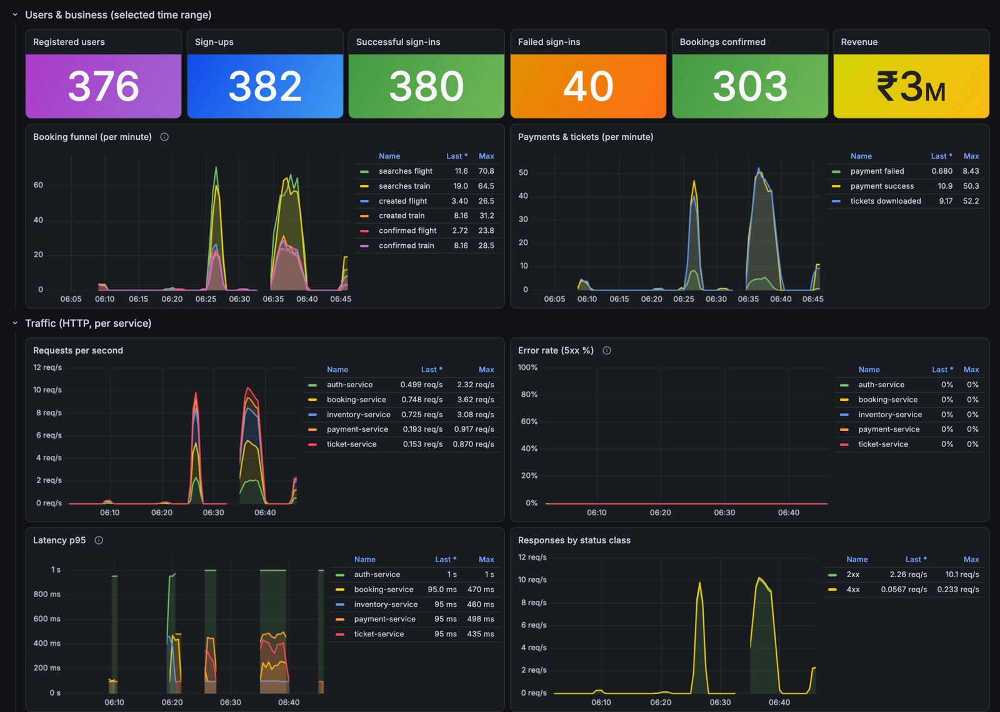

---

## Contents
- [What it does](#what-it-does)
- [Highlights](#highlights)
- [Architecture](#architecture)
- [CI/CD pipeline](#cicd-pipeline)
- [Screenshots](#screenshots)
- [Tech stack](#tech-stack)
- [Quick start](#quick-start)
- [Repository structure](#repository-structure)
- [Documentation](#documentation)

## What it does
**Sign up → choose flight or train → search → passenger details → pay (dummy gateway) → download a PDF ticket.**

The app is intentionally simple; the focus is everything around it: containers, Kubernetes,
CI/CD, observability and operations.

## Highlights
| Area | What's implemented |
|---|---|
| **Microservices** | 5 FastAPI services + React frontend, database-per-service, JWT auth, service-to-service calls |
| **Containers** | Multi-stage Dockerfiles (builder → test → Alpine runtime, ~21% smaller), non-root users, BuildKit cache mounts |
| **Kubernetes** | Self-built **kubeadm** cluster (1 control plane + 2 workers), Kustomize manifests, probes, resource limits, rolling updates with zero downtime, Postgres StatefulSet with persistent volume |
| **CI/CD** | Jenkins: tests inside Docker, **parallel image builds in batches of 3**, push to Docker Hub, deploy, smoke test, **automatic rollback** |
| **Security** | Least-privilege RBAC for Jenkins (namespace-scoped), DB user per service, internal endpoints never exposed, only card last-4 stored |
| **Metrics** | Prometheus + Grafana: nodes, pods, HTTP traffic/latency/errors **and business metrics** (users, bookings, revenue) |
| **Logs** | Loki + Grafana Alloy: all pod logs, JSON log levels as labels, request-ID tracing |
| **Ingress** | Traefik: `quickbook.localhost`, `grafana.localhost`, `prometheus.localhost` |
| **Testing** | 41 backend + 4 frontend unit tests, end-to-end smoke test, 100-user traffic simulator |

## Architecture

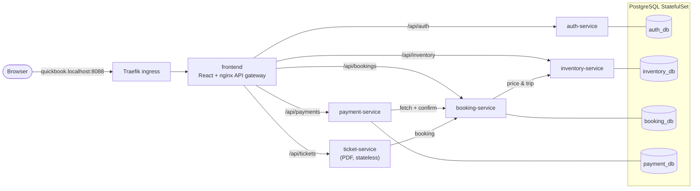

| Service | Responsibility | Data |
|---|---|---|
| **auth-service** | sign up / sign in, issues JWTs | `users` |
| **inventory-service** | flight & train schedules, search | `schedules` (seeded on start) |
| **booking-service** | bookings, PNR, confirmation after payment | `bookings` |
| **payment-service** | dummy card gateway (Luhn, expiry, decline card) | `payments` (last 4 digits only) |
| **ticket-service** | renders the PDF e-ticket | — stateless |
| **frontend** | React UI; nginx serves it and routes `/api/*` | — |

<details>
<summary><b>Key design decisions</b></summary>

- **Database per service** — one Postgres server, a separate database *and user* per service; services
  never read each other's tables, only call each other's APIs.
- **Stateless JWT** — auth-service signs; others verify with the shared secret (no call back per request).
- **Server-side prices** — booking gets the price from inventory, payment gets the amount from booking;
  the browser can't tamper with money.
- **Internal endpoint** `/internal/bookings/{id}/confirm` needs a service token and is blocked at the gateway.
- **Every service** exposes `/health` (liveness), `/ready` (readiness, checks DB), `/metrics`, and logs JSON to stdout.
</details>

### Platform
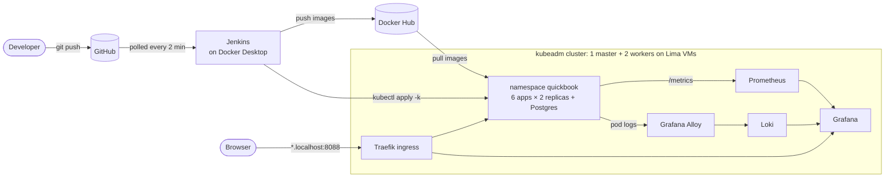

## CI/CD pipeline
Every merge to `main` is built, tested and deployed automatically ([`Jenkinsfile`](Jenkinsfile)).

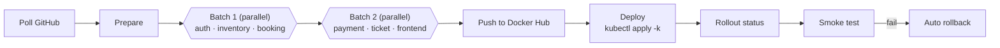

- **Test & build**: each parallel branch runs `docker build --target test` (unit tests inside the image), then builds the runtime image.
- **Tags**: `<app>-<build number>` (e.g. `auth-service-12`); the git commit is stored as an OCI label.
- **Deploy**: Kustomize sets the new tags; rolling update with `maxUnavailable: 0`.
- **Verify**: rollout status + end-to-end smoke test (signup → book → pay → PDF).
- **Rollback**: on failure, `rollout undo` — only for deployments running this build's image.

## Screenshots

### Monitoring (Grafana)
| Business & traffic | Pods & nodes |
|---|---|
|  | 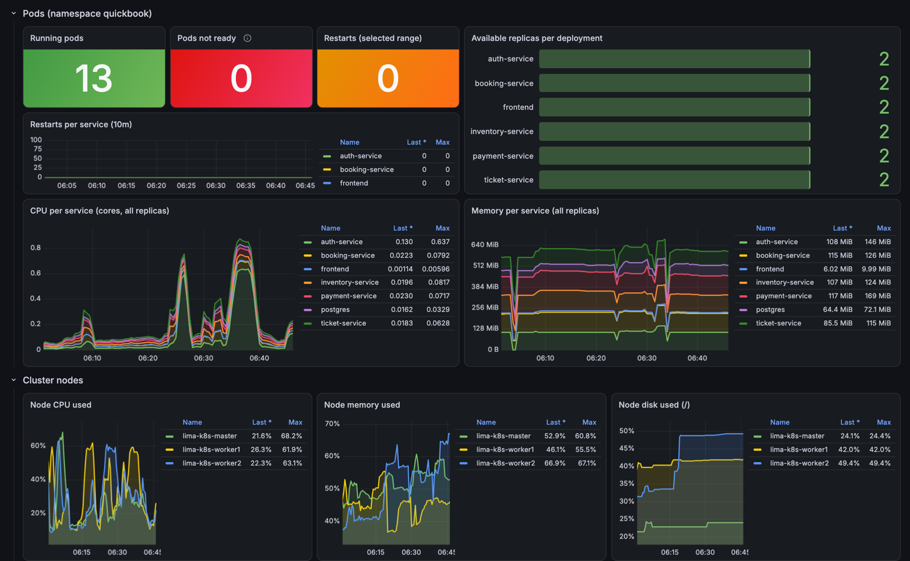 |
| **Logs (Loki)** | **Node Exporter** |
| 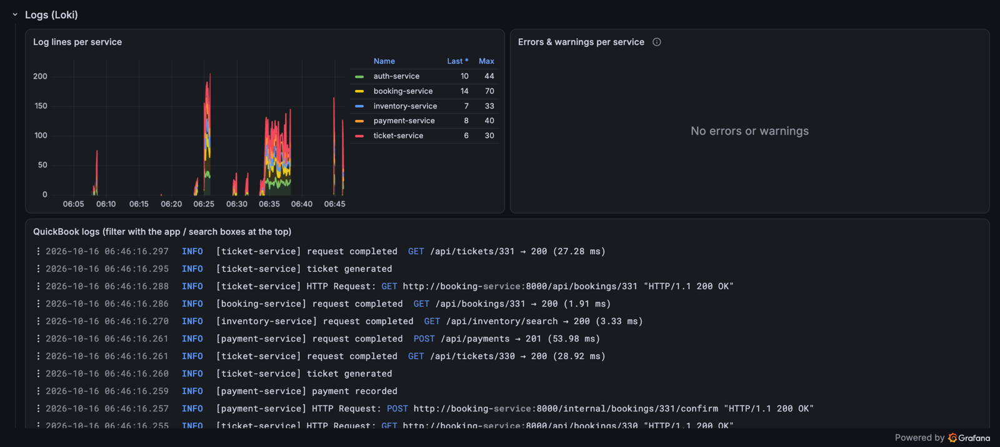 | 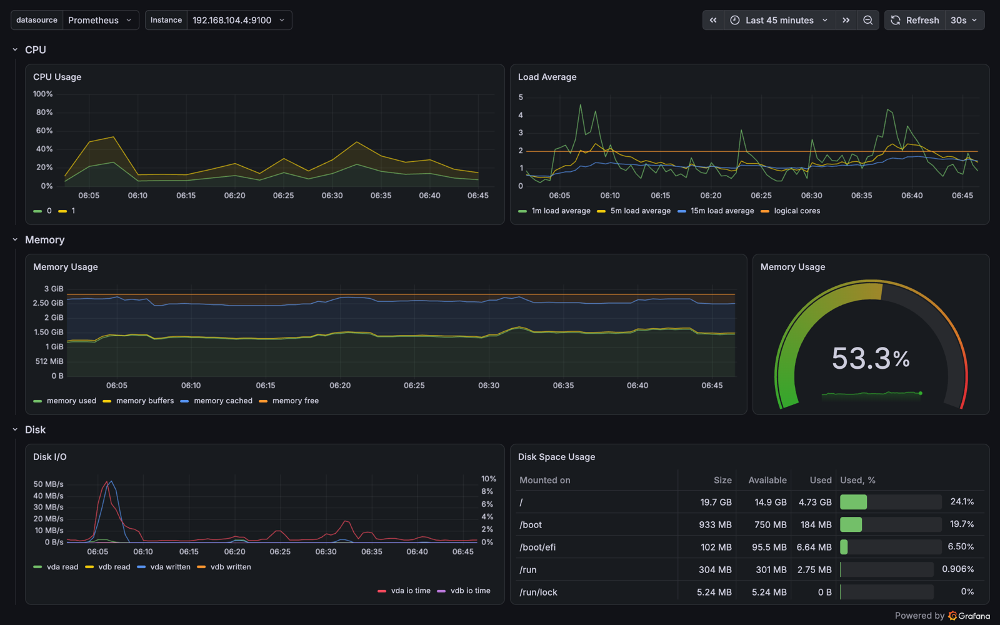 |

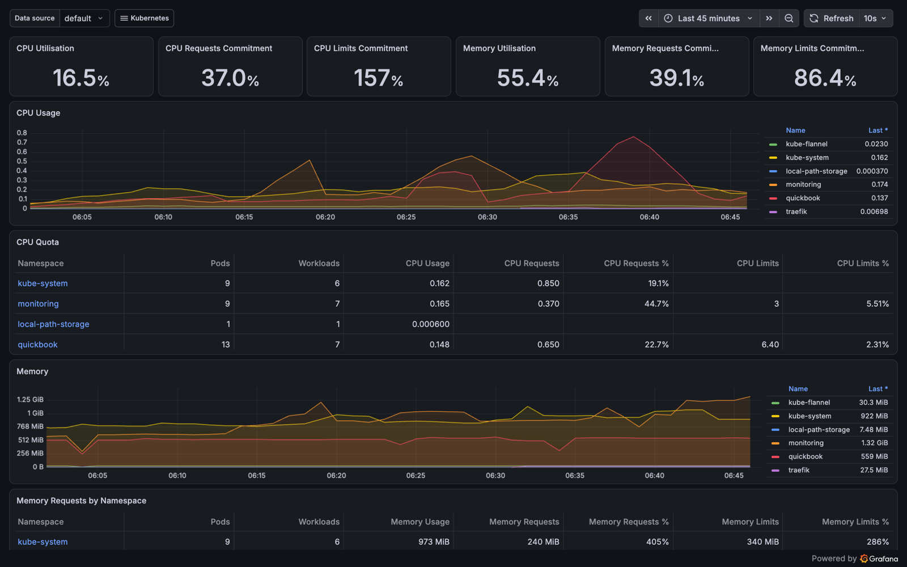

### Application
| Choose travel mode | Search results |
|---|---|
| 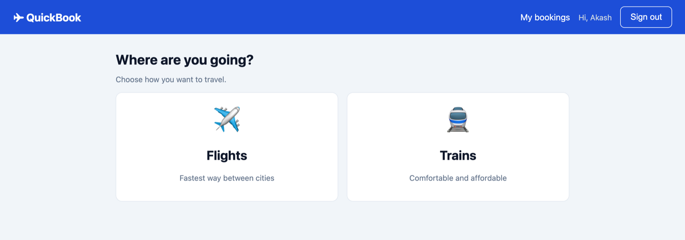 | 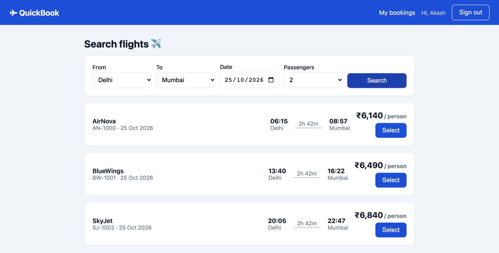 |
| **Payment (dummy gateway)** | **Booking confirmed** |
| 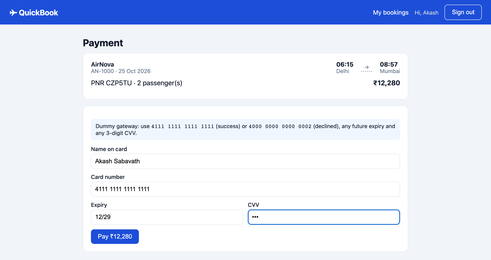 | 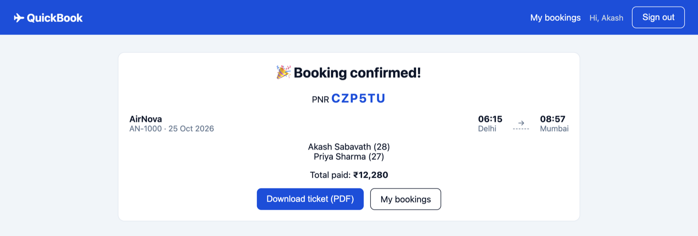 |
| **My bookings** | **PDF e-ticket** |
| 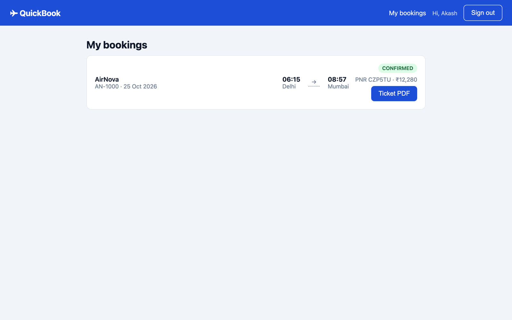 | 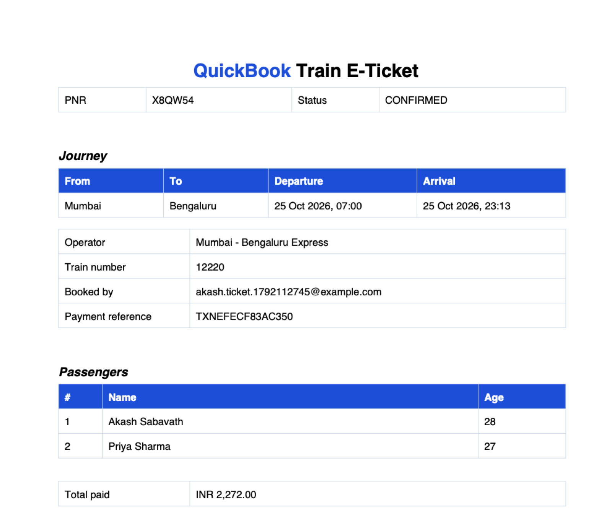 |

## Tech stack
| Layer | Tools |
|---|---|
| Backend | Python 3.11, FastAPI, SQLAlchemy, PyJWT, bcrypt, ReportLab |
| Frontend | React 18, Vite, React Router, nginx (unprivileged) |
| Data | PostgreSQL 16 (StatefulSet, local-path PV) |
| Containers | Docker, BuildKit, multi-stage builds, Alpine |
| Orchestration | Kubernetes 1.34 (kubeadm), containerd, Flannel, Kustomize, Helm, Lima VMs |
| CI/CD | Jenkins (LTS, Docker Desktop), Docker Hub, GitHub |
| Observability | Prometheus, Grafana, node-exporter, kube-state-metrics, Loki, Grafana Alloy |
| Ingress | Traefik |
| Testing | pytest, Vitest, Python E2E smoke test, traffic simulator |

## Quick start

**Locally with Docker Compose** (no Kubernetes needed):
```bash
git clone https://github.com/chavanakash/quickbook.git && cd quickbook
docker compose up --build -d
open http://localhost:3000            # test card: 4111 1111 1111 1111
python3 scripts/smoke_test.py         # end-to-end check
```

**On Kubernetes** — follow the guides in order:
1. [Build the cluster](cluster/README.md) (Lima + kubeadm)
2. [Ingress](ingress/README.md) (Traefik)
3. [Deploy the app](k8s/README.md) (`kubectl apply -k k8s/`)
4. [Monitoring & logs](monitoring/README.md) (Prometheus, Grafana, Loki)
5. [CI/CD](ci/jenkins/README.md) (Jenkins)

| URL | |
|---|---|
| http://quickbook.localhost:8088 | QuickBook |
| http://grafana.localhost:8088 | Grafana (`admin`) |
| http://prometheus.localhost:8088 | Prometheus |

## Repository structure
```
├── services/                 5 FastAPI microservices (app/, tests/, Dockerfile each)
│   ├── auth-service/
│   ├── inventory-service/
│   ├── booking-service/
│   ├── payment-service/
│   └── ticket-service/
├── frontend/                 React app + nginx gateway config
├── k8s/                      Kubernetes manifests (Kustomize) for the app
├── cluster/                  kubeadm cluster setup (Lima VMs, node-setup.sh)
├── ingress/                  Traefik ingress controller
├── monitoring/               Prometheus/Grafana/Loki/Alloy values, dashboard, ServiceMonitor
├── ci/jenkins/               Jenkins image, compose file, RBAC for deployments
├── scripts/                  smoke test, 100-user traffic simulator
├── docs/                     development guide, screenshots
├── db/init/                  per-service databases for docker-compose
├── Jenkinsfile               CI/CD pipeline
├── docker-compose.yml        local stack
└── Makefile                  shortcuts (test, up, down, smoke)
```

## Documentation
| Guide | |
|---|---|
| [cluster/README.md](cluster/README.md) | Building the kubeadm cluster on Lima VMs |
| [k8s/README.md](k8s/README.md) | Kubernetes manifests and operations |
| [ci/jenkins/README.md](ci/jenkins/README.md) | Jenkins setup, credentials, pipeline design |
| [monitoring/README.md](monitoring/README.md) | Prometheus, Grafana, Loki, business metrics, LogQL |
| [ingress/README.md](ingress/README.md) | Traefik and how traffic reaches the cluster |
| [docs/development.md](docs/development.md) | Local development, tests, config, API endpoints |
| [docs/handbook/](docs/handbook/index.html) | **DevOps handbook**: images, parallel builds, cache, manifests, probes, rollouts, monitoring, latency, lessons learned. Run it locally: `docker compose -f docs/handbook/docker-compose.yml up -d` → http://localhost:8099 |

---
<sub>Demo project for learning DevOps — payments are fake and tickets are not valid for travel.
Lab secrets in <code>k8s/secrets.yaml</code> are for a local cluster only.</sub>
