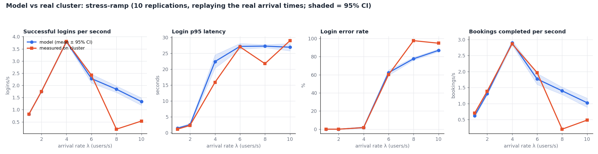
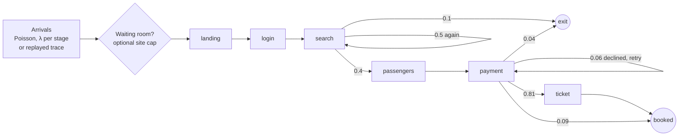
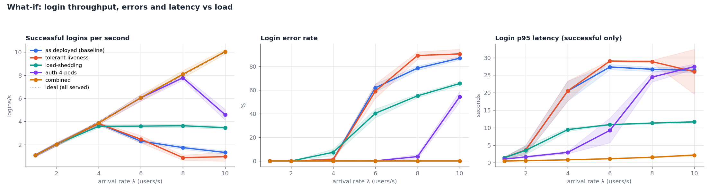
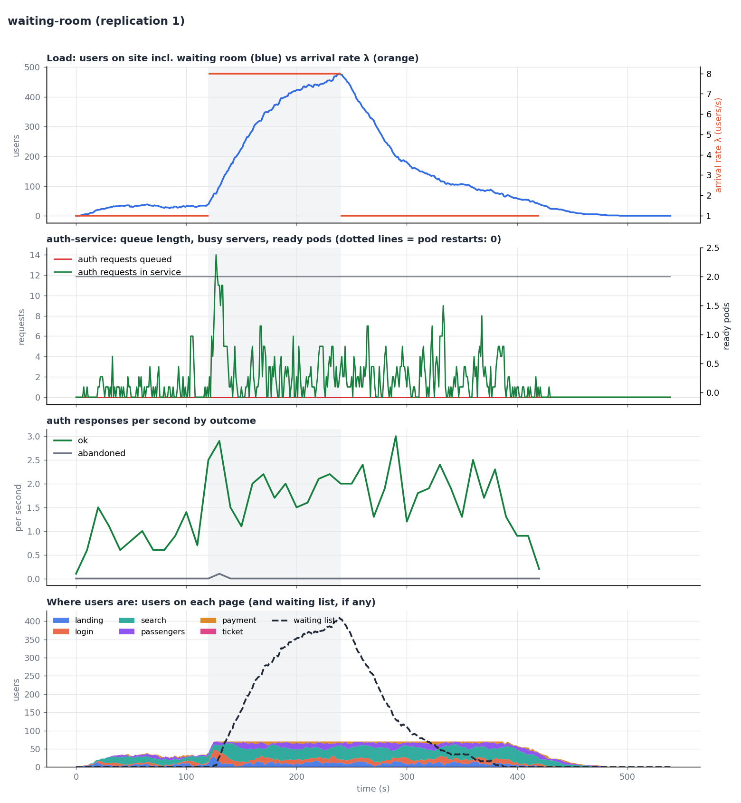

# Capacity model: a validated simulation of QuickBook on Kubernetes

A **discrete-event simulation** (SimPy) of the whole platform – users, pages, pods, CPU limits, thread pools,
health probes, timeouts and restarts – **calibrated from real load tests and validated against the real cluster**.
It answers capacity questions in seconds, without touching the cluster:
*Where does it break? Why? Which fix actually helps?*



## Headline results

| Question | Answer |
|---|---|
| Capacity as deployed | **~3.8 logins/s**, predicted from low-load calibration alone (2 pods × 0.5 core ÷ 0.263 CPU-s per bcrypt login) and confirmed on the cluster (3.80/s) |
| Model accuracy | Replaying the real arrival times: goodput **3.80 vs 3.80/s** and error rate **1.8% vs 1.7%** at the knee; **62% vs 60%** errors at 1.5× overload; steady-load p95 **2.07 ± 0.14 s vs 2.25 s** measured |
| Why it collapses | CPU limit → thread pool shares 0.5 core between up to 40 requests → each login takes ~20 s → probes time out → readiness drops pods (502) and liveness restarts them |
| Fix that looked obvious but **hurts** | A tolerant liveness probe alone: goodput at 2× overload falls **1.74 → 0.87/s** – restarts were accidentally shedding dead work |
| Fixes that work | Load shedding (bounded queue, fast 503) keeps goodput at **~3.6/s** instead of collapsing; 4 auth pods × 1 core serves **10 users/s with 0 errors** |
| Flash sale (8 users/s, impatient users who retry) | A **waiting room** (max 70 users admitted) raises bookings **0.63 → 2.52/s (4×)**, login errors **92% → 0.5%**, pod restarts **5 → 0** |

## How it works



Every page is **one request** to a service, followed by a **dwell time** drawn from a distribution
(lognormal, exponential, gamma, mixtures …) and a **routing decision** (a Markov chain; rows sum to 1).

Every service is a set of **pods**. A pod is a **limited processor-sharing server** – exactly how uvicorn's
thread pool behaves: up to `threads` requests (default 40) share the pod's **CPU limit**; the rest wait FIFO.
A request needing *c* CPU-seconds alone takes *c / cpu_limit* seconds, which reproduces CFS throttling.

On top of that, the parts of Kubernetes that decide how a system fails:

| Modelled | Behaviour |
|---|---|
| Readiness probe | Shares the pod's threads/CPU; 3 failures → pod removed from the Service (requests get 502) |
| Liveness probe | 3 failures → pod restarted, all its requests fail (502), with **CrashLoopBackOff** (10 s, 20 s, 40 s …) |
| Gateway timeout | 30 s → 504; the server **keeps working** on the abandoned request (wasted work) |
| Users | Optional patience (abandon), retries with backoff, waiting-room patience |
| Load shedding | Optional bounded queue per pod → immediate 503 |

### Calibration
`calibrate.py` reads a real load-test CSV, takes the **lowest-load stage** (no queueing, so latency ≈ service time),
fits a lognormal per page and converts it to CPU-seconds (latency × CPU limit). Login: **0.263 CPU-s**.

### Validation against queueing theory (`tests/`)
The engine must reproduce closed-form results before it is trusted:

| Test | Theory | Result |
|---|---|---|
| M/M/1 mean response time | W = 1/(μ−λ) = 3.33 s | within 8% |
| M/D/1 (FIFO) | Pollaczek–Khinchine: 2.17 s | within 6% |
| M/D/1-PS (processor sharing) | W = S/(1−ρ) = 3.33 s | within 8% |
| CPU limit | 0.25 CPU-s on 0.5 core = 0.5 s | exact |
| Little's Law | L = λW | within 15% |
| Probes | overload → restarts; light load → none | ✓ |

## What-if experiments



At λ = 8 users/s (2× capacity), 10 replications each:

| Scenario | Logins/s | Login errors | Bookings/s |
|---|---|---|---|
| As deployed (baseline) | 1.74 ± 0.15 | 78.5% | 1.39 |
| Tolerant liveness only | 0.87 ± 0.23 | 89.2% | 0.68 |
| Load shedding (8 threads + 10 queued per pod, fast 503) | **3.63 ± 0.13** | 55.1% (fast rejections) | 2.84 |
| 4 auth pods (what an HPA would do) | 7.79 ± 0.21 | 3.7% | 6.02 |
| 4 pods × 1 core + tolerant liveness | **8.10 ± 0.32** | **0%** | 6.25 |

**Thread pool × queue limit sweep** (`simulate.py sweep`) shows the trade-off triangle: smaller limits give
lower latency (p95 ~3 s with 1 thread) but reject more traffic near capacity; unbounded queues collapse.

### Flash sale: the waiting room



The site is capped at 70 admitted users (sized with Little's Law: ~3 users/s × ~23 s);
everyone else waits at the entrance (dashed line). During the sale window:

| | No waiting room | Waiting room |
|---|---|---|
| Login errors | 92.3% | **0.5%** |
| Login p95 | 21.6 s | **4.1 s** |
| Bookings/s | 0.63 | **2.52** |
| Pod restarts per run | 5 | **0** |
| Sale visitors who booked | 8% | **32%** |

Compare with [the same sale without it](results/flash-sale/timeline.png).

## Run it
```bash
.venv/bin/pip install -r capacity-model/requirements.txt

# one scenario, 10 replications -> table + results/<scenario>/timeline.png
.venv/bin/python capacity-model/simulate.py run capacity-model/scenarios/stress-ramp.json --reps 10

# override anything on the command line
.venv/bin/python capacity-model/simulate.py run capacity-model/scenarios/stress-ramp.json --set services.auth.pods=3

# model vs the real cluster, replaying the real arrival times
.venv/bin/python capacity-model/simulate.py validate capacity-model/scenarios/stress-ramp.json \
    capacity-model/data/real-stress-ramp.csv --trace

# what-ifs on the same ramp -> results/compare/knee-curves.png
.venv/bin/python capacity-model/simulate.py compare capacity-model/scenarios/stress-ramp.json capacity-model/scenarios/whatif-*.json

# grid search
.venv/bin/python capacity-model/simulate.py sweep capacity-model/scenarios/whatif-load-shedding.json \
    --grid services.auth.threads=1,2,4,8,40 --grid services.auth.max_queue=4,10,30

# recalibrate from a new real load test
.venv/bin/python capacity-model/calibrate.py capacity-model/data/real-stress-ramp.csv --stage "λ=1"

.venv/bin/pytest -q capacity-model/tests
```

| File | Purpose |
|---|---|
| `qbsim/model.py` | SimPy engine: arrivals, user journeys, processor-sharing pods, probes, restarts, waiting room |
| `qbsim/distributions.py` | Distribution samplers + analytical means |
| `qbsim/analysis.py` | Per-stage summaries, 95% confidence intervals, Little's Law, real-CSV parsing |
| `qbsim/plots.py` | Timeline, validation and knee-curve charts |
| `scenarios/*.json` | Scenarios (inherit from `base.json`; `calibration.json` = measured CPU demand) |
| `simulate.py` | CLI: `run`, `validate`, `compare`, `sweep` |
| `calibrate.py` | CPU demand from a real load test |
| `data/real-*.csv` | The real load-test runs (every request) used for calibration and validation |

## Limitations (stated, not hidden)
- **Deep overload (≥ 2× capacity)** – the model collapses (78–87% errors) but less than the real cluster did
  (95–98%). Likely unmodelled: Python GIL / thread-switching overhead under throttling, and the load generator
  sharing the Mac with the VMs. Predictions up to ~1.5× capacity match within the confidence intervals.
- **Latency at the knee is over-predicted** (login p95 22 s vs 16 s measured at λ = 4) while throughput and error
  rate match: real thread scheduling is not perfectly fair, so some requests finish faster than ideal processor sharing.
- Downstream calls (payment → booking, booking → inventory) are folded into each request's CPU demand; Postgres and
  nginx are not bottlenecks here and are not modelled as separate queues.
- Calibrated on one cluster and one code version: recalibrate after changing bcrypt cost, CPU limits or hardware.
